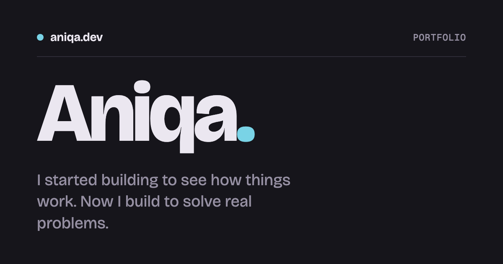
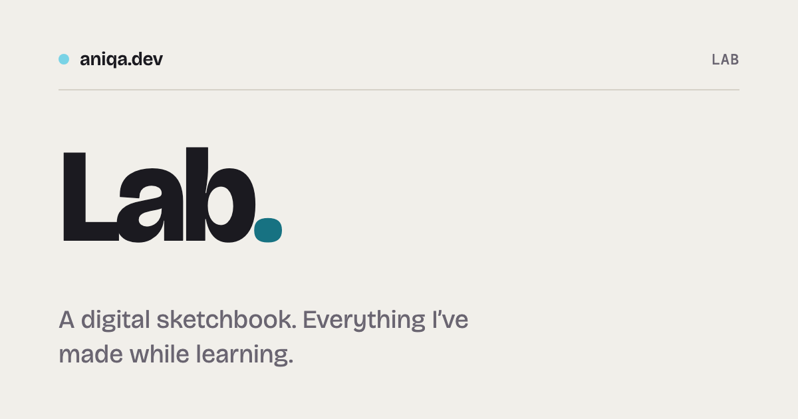

# aniqa.dev

Aniqa's portfolio, lab, and app reviews, built with Astro and hosted on Vercel.

- **Portfolio:** [aniqa.dev](https://aniqa.dev) — selected work and case studies
- **Lab:** [aniqa.dev/lab](https://aniqa.dev/lab) — experiments, studies, and notes
- **Reviews:** [aniqa.dev/reviews](https://aniqa.dev/reviews) — indie app reviews
- **Source:** [github.com/aniqatc/aniqa.dev](https://github.com/aniqatc/aniqa.dev)

The lab lives at `/lab`. Pages are static except likes and sign-ups.

| Portfolio                                     | Lab                               |
| --------------------------------------------- | --------------------------------- |
|  |  |

Entry Open Graph images are in `public/og/`. After changing a title, blurb, or screenshot, run `npm run og` and include the updated images.

## Tech

- Astro 7, strict TypeScript, plain CSS, Sätteri, Vercel adapter
- Fontsource: Bricolage Grotesque, Geist, Geist Mono
- Upstash Redis for likes; Buttondown for sign-ups
- Playwright for screenshots and share cards
- p5.js and Three.js for experiments that need them

## Features

- Portfolio case studies and “Building now” section
- Lab archive by year, favorites, random entry, likes, and mouse-only hover previews
- Live experiment stages with optional themes and controls
- Reviews with scores, app screenshots, and shareable scorecards
- Generated Open Graph images, page transitions, and an animated calendar pet

## Pet calendar

The default is `auto` in `src/lib/pets.ts`. Set `PET` there to a pet name to pin one.

| Dates                                                   | Pet                                     |
| ------------------------------------------------------- | --------------------------------------- |
| Jan 1–7                                                 | Party                                   |
| Jan 8–31                                                | Penguin                                 |
| Feb 1–14 / Feb 15–29                                    | Heart / mochi                           |
| March / April / May / June                              | Chick / bunny / sprout / bee            |
| July–August / September / October / November / December | Frog / owl / pumpkin / acorn / snowball |

Date overrides: Feb 27 cupcake; Mar 27, May 5, June 26, Oct 18 heart; June 30 and Sep 20 cupcake; Oct 31 ghost; Dec 25 tree; Dec 31 party. Mother's Day and Father's Day use party; Eid uses moon; Diwali uses diya for all five days (2 either side of the main date); Lunar New Year uses lantern. Moving-date rules and calendars are in `src/lib/pets.ts`.

Click the dot by the site name to reveal the pet. It follows pointer movement or taps. Reduced-motion settings reduce its movement and animation.

## Accessibility

- Semantic links and controls, accessible names, and visible keyboard focus
- Hover previews only on mouse; links work on touch screens
- Reduced-motion preferences disable or reduce animations

## Project structure

```text
src/content/projects/      Portfolio case studies
src/content/experiments/   Lab entries and studies
src/content/reviews/       App reviews
src/components/            Shared Astro components
src/lib/                    Content helpers and site data
src/pages/                  Routes and API endpoints
src/scripts/                Browser interactions
src/styles/                 Tokens and shared styles
templates/                  Entry scaffolds
scripts/                    Build and image tools
public/og/                  Generated preview images
```

## Key concepts

- One folder per entry, with `index.md`; schemas are in `src/content.config.ts`.
- Lab entries with `sketch.ts` or `sketch.astro` run on the page. Others link out.
- `stage: frame` is fixed-ratio; `stage: fit` grows to fit studies.
- `themes: true` adds day/night controls to a stage.
- `draft: true` hides entries from production; `favorite: true` pins a lab entry.
- Projects and lab entries need `screenshot.png` and descriptive `screenshotAlt`.

## Setup

Requires Node.js 22.22 or newer.

```sh
npm install
cp .env.example .env.local
npx playwright install chromium
npm run dev
```

The site builds without credentials. Add the variables needed for these features:

| Variable                   | Used for                                                                   |
| -------------------------- | -------------------------------------------------------------------------- |
| `BUTTONDOWN_API_KEY`       | Email sign-ups                                                             |
| `UPSTASH_REDIS_REST_URL`   | Likes database URL                                                         |
| `UPSTASH_REDIS_REST_TOKEN` | Likes database token                                                       |
| `GITHUB_TOKEN`             | Optional GitHub API reads, such as star counts                             |
| `VERCEL_DEPLOY_HOOK`       | GitHub Actions secret for daily star refresh; not an `.env.local` variable |

Upstash also accepts `KV_REST_API_URL` and `KV_REST_API_TOKEN` as aliases.

### NPM scripts

| Command                           | What it does                                                       |
| --------------------------------- | ------------------------------------------------------------------ |
| `npm run dev`                     | Start the site at `localhost:4321` (foreground; stop with Ctrl+C). |
| `npm run start`                   | Alias for `npm run dev`.                                           |
| `npm run build`                   | Type-check and build.                                              |
| `npm run check`                   | Run Astro checks.                                                  |
| `npm run lint`                    | Run ESLint.                                                        |
| `npm run format` / `format:check` | Format files / check formatting.                                   |
| `npm run new`                     | Scaffold a project, experiment, or review.                         |
| `npm run screenshots`             | Capture content screenshots; pass slugs to select entries.         |
| `npm run og`                      | Generate Open Graph images.                                        |
| `npm run scorecard -- <slug>`     | Generate a review scorecard.                                       |

There is no preview script for the Vercel adapter.

## Adding content

Each entry is a folder under `src/content/`. Start with the matching command below, then:

1. Edit the new folder's `index.md`: complete its frontmatter and write-up.
2. Add `screenshot.png` and describe what it shows in `screenshotAlt`.
3. Run `npm run og`, then check the page locally with `npm run dev`.

The scaffold prints the new folder path and the next steps. Use `draft: true` to keep a project or experiment out of production while you work. Reviews start as drafts automatically.

### Portfolio project

```sh
npm run new -- --kind project --title "Title" --slug slug
```

1. Edit `src/content/projects/<slug>/index.md`. Fill in `released`, `type`, `stack`, `blurb`, `summary`, and `order`.
2. Write `Why`, `What it does`, and `What I learned` in first person. Keep each point specific and short. Add `Hardest part` or dated `Revisited` only when you have something useful to add.
3. Add the screenshot and alt text. The screenshot script captures the live site in dark mode.

### Lab note that links out

```sh
npm run new -- --kind experiment --sketch none --title "Title" --slug slug
```

1. In `src/content/experiments/<slug>/index.md`, fill in `live` (the site host) and `repo` (the GitHub repository name, if public).
2. Write `Why I built it` and `What I learned`. Keep the notes brief and specific. If this is a CodePen migration, put its URL in `v1` and describe the migration in `Revisited`.
3. Run `npm run screenshots -- <slug>` to capture the live site in light mode. Add alt text describing the screenshot.

### On-site experiment

```sh
npm run new -- --kind experiment --sketch canvas --title "Title" --slug slug
```

1. Choose `canvas`, `css`, `p5`, or `three` in `--sketch`. The scaffold creates `sketch.ts` for canvas, p5, and Three.js, or `sketch.astro` for CSS art. Install p5.js or Three.js if needed, then restart the dev server.
2. In `index.md`, fill in the type, stack, summary, and optional `hint`. Write an `Idea` and a few short `Notes` about what you tried, tuned, or learned.
3. Set `stage: frame` for a fixed stage or `stage: fit` when the stage should grow with the sketch. Capture the screenshot with `npm run screenshots -- <slug>` and add alt text.

### CSS or JavaScript study

```sh
npm run new -- --kind experiment --sketch study --title "Title" --slug slug
```

1. Edit `sketch.astro` to build the study. Use the shared controls and styles in `src/styles/demo.css`.
2. In `index.md`, set `type` to `CSS study` or `JS study`, and fill in the summary and hint. Write an `Idea` and `Notes` that explain the concept, the technique, and what you noticed while testing it.
3. For a CodePen migration, put the original URL in `v1` and add a dated `Revisited` note. Capture the screenshot with `npm run screenshots -- <slug>` and add alt text.

### App review

```sh
npm run new -- --kind review --app "App name" --maker handle --live example.com
```

1. Fill in the review's date, `triedOn`, scores, verdict, and brand colour in `index.md`.
2. Write `First look`, `What I liked`, `Small ideas`, and `Who it's for`. Use concrete details from trying the app; keep suggestions kind and specific. To show a detail, put a screenshot in the review folder and add it to the point, either framed under it or as a picture note in the text (see [Pictures in a review](#pictures-in-a-review)).
3. For a web app, run `npm run screenshots -- reviews/<slug>` to capture the app and its icon. For a phone or tablet app, add screenshots from the device and set `device` to `phone` or `tablet`; for a Mac app, see [Mac apps](#mac-apps). Optional `price`, `version` and `platforms` show with the facts.
4. Run `npm run scorecard -- <slug>` to make the share image. Check the draft locally, remove `draft: true` when ready, then run `npm run og` for the review's link preview.

#### Pictures in a review

There are two ways to show a picture in a review's notes. Both open it full size when clicked (or focused and
opened with Enter), with its caption under it, and you can mix them in one review. Crop to the part that matters.

**Framed**, under the point: the picture sits in a narrow frame below the text. Leave a blank line before it.

```md
1. **Make it yours.** There are 21 tabs, but you can remove what you don't need.

   
```

Add a caption with an _italic_ line straight after the image. It shows in a strip along the bottom of the frame.

```md

_The tab grid, with Pet care open_
```

Two images on one line sit side by side, for phone screens, and share one caption.

```md
 
_Before and after the first entry_
```

**Picture note**, in the text: give the image the title `"note"` and put it right after the words it shows. It
becomes a small chip in the line, so the sentence keeps reading normally.

```md
1. **Make it yours.** There are 21 tabs , but you can remove what you don't need.
```

Add a caption after a colon in the title. It shows under the picture when it opens.

```md
1. **The pet.** Bombay  peeks
   out of the notch.
```

| You write                              | It shows as                               | Caption from                |
| -------------------------------------- | ----------------------------------------- | --------------------------- |
| ``                   | A framed picture under the point          | An _italic_ line after it   |
| ` `      | Two framed pictures side by side          | An _italic_ line after them |
| ``            | A chip in the text that opens the picture | None                        |
| `` | A chip in the text that opens the picture | The text after `note:`      |

The alt text describes the picture for screen readers either way; any other title leaves a picture framed.

#### Mac apps

Set `device: desktop`. `screenshot.png` is only the app, with no background, and the site draws the Mac screen around it: the wallpaper (tinted with `brand`), the menu bar, the notch, and the Dock. The image is treated as a 2× (Retina) capture and shown at half its pixel size, so it is never stretched.

| `desktop`          | What it shows                                      | How to capture                                                                  |
| ------------------ | -------------------------------------------------- | ------------------------------------------------------------------------------- |
| `window` (default) | The window in the middle of a MacBook, with a Dock | Cmd+Shift+4, Space, then Option-click the window (no shadow)                    |
| `menubar`          | A popover hanging under its menu bar icon          | Cmd+Shift+4, Space, then click the popover, or a tight drag; leave out the icon |
| `notch`            | A panel growing out of the notch                   | Drag-select from the top edge of the screen around the panel                    |

Add the app icon as `logo.png`; it becomes the icon in the Dock and the menu bar (without it, the first letter on the brand colour). The site adds a soft shadow; set `shadow: false` if the capture already has one.

## Changelog

### October 2026 — v2

- Rebuilt the portfolio in Astro; added the lab, reviews, likes, pets, and generated share images.

### 2025 — v1

- Published the original React portfolio. See the [`react-v1` tag](https://github.com/aniqatc/aniqa.dev/tree/react-v1).

## License

Code is [MIT](LICENSE). Writing, experiments, and images are © Aniqa, all rights reserved.
