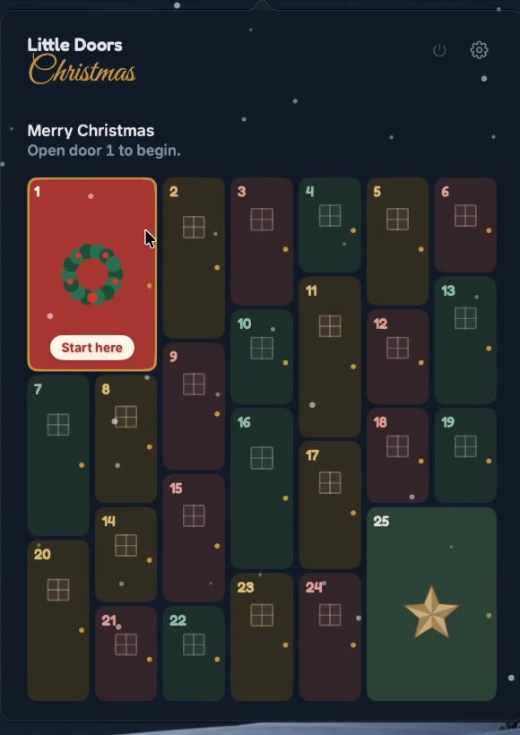

## Why

Every year my husband gets me an advent calendar or two: jewellery, skincare, candy, little accessories. The holidays have always been a big deal for us. This year, a few months after our son was born, he brought home a beauty advent calendar, and I wondered why there wasn't one for my computer. I'm on my laptop all day. I don't always notice the decorations around the house, but I'd notice something on my screen.

I looked for an advent calendar app for the Mac and couldn't find anything that does this. There are countdown widgets and wallpaper packs, but nothing where you open a door each day and it actually changes your desktop. [Check this against what you found, and name anything close.] So I built it. It's the first thing I've made that people pay for.

## What it does

1. Lives in the menu bar. Click the little door and the calendar opens: 25 doors, a surprise behind each one.

   
   _The calendar on day one, with door 1 ready_

2. Behind the doors are things for your desktop. Decorate a Christmas tree, with a new ornament behind every door, then light it up . Build a snowman , and hang stockings with the names you choose .
3. Some reach past the desktop. Sleighs ride along your Dock, even when it magnifies . Windows frost over, and you can draw in the frost with your pointer . Step away and your windows get wrapped like presents, ready to unwrap when you're back .
4. Make it yours: pick the snowman's hat and scarf, name the stockings, and save a look to come back to. When you need a clean screen, Hide all puts everything away with one shortcut.

## Hardest part

[The one problem that took the most work, and how you solved it.]

## What I learned

1. [Something about building a menu bar app with SwiftUI and AppKit together.]
2. [Something about shipping outside the App Store: signing, notarising, Sparkle updates.]
3. [Something about selling it: keys, payments with Dodo, gift emails with Loops.]
4. [Something about launching an indie Mac app on your own.]

## Launch

[Launch day, and where you posted it: Show HN, X, Product Hunt…]

[How it went, with honest numbers: two sales in the first few days, and what people said.]

[What you tried next, and what worked.]

## What's next

Christmas is the first edition. Spring is next, then Independence Day, and more after that. If you want to hear when the next one is out, there's a [sign-up on the site](https://littledoors.app/coming-soon).

## Trying it

Little Doors: Christmas is out now for macOS, on [littledoors.app](https://littledoors.app/christmas). You can start any time; your first door opens the day you install it. There's a Standard Key, and a Golden Key that comes with a surprise gift. You can also [send it as a gift](https://littledoors.app/christmas/gift): it arrives by email with your note, which makes it an easy last-minute present for someone who spends the day at a Mac.
