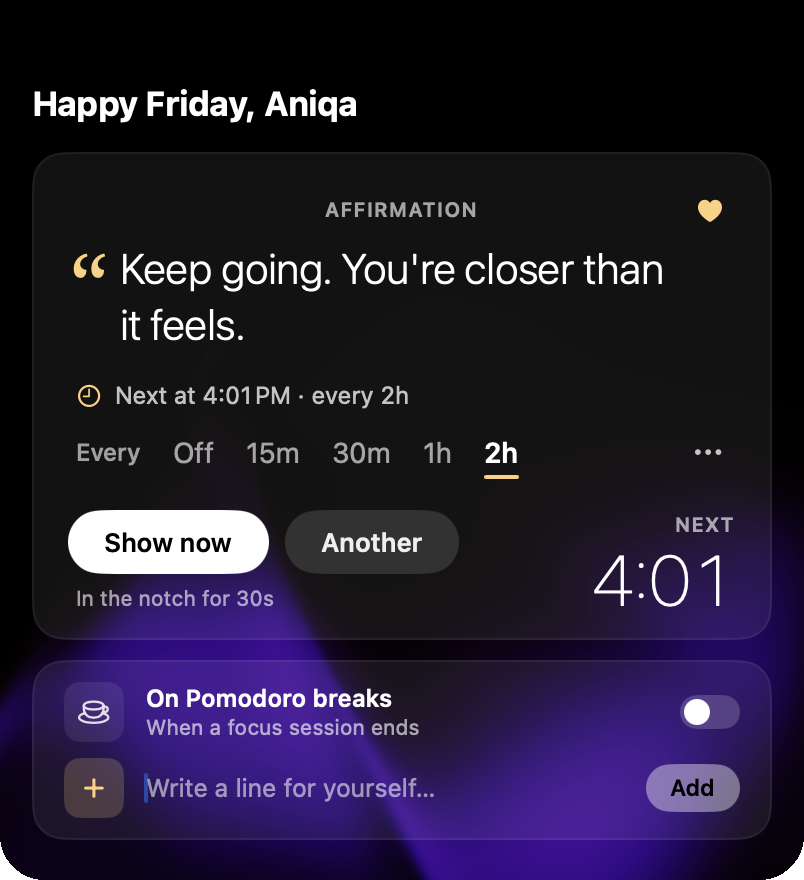
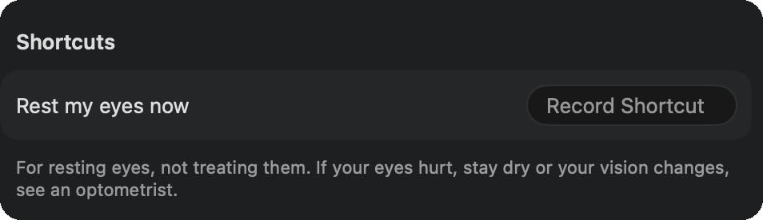
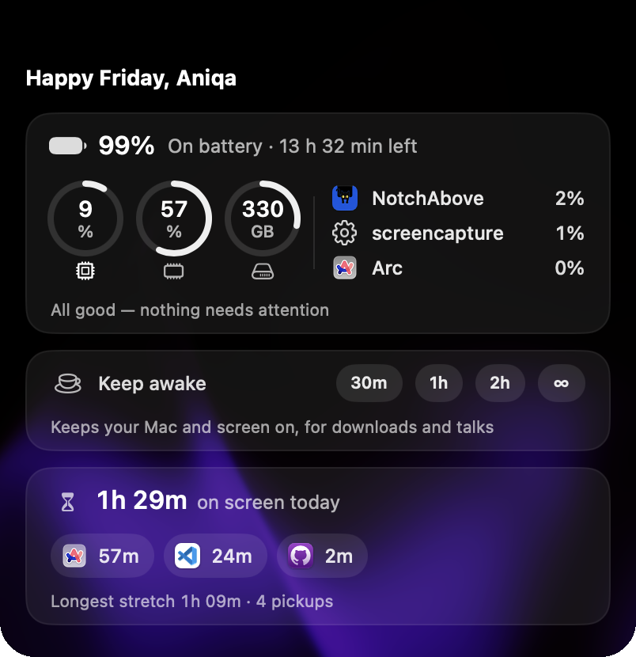
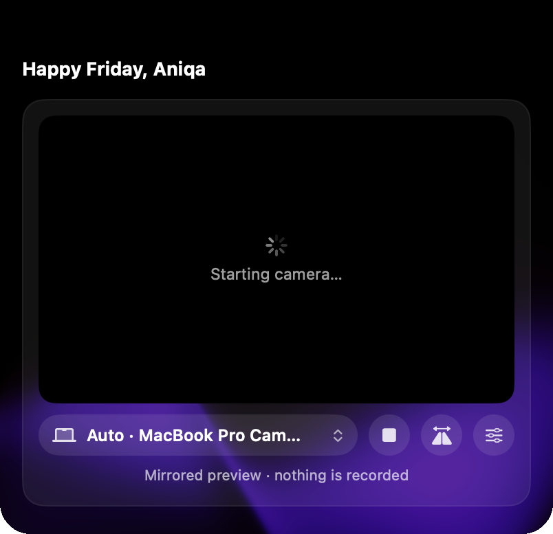
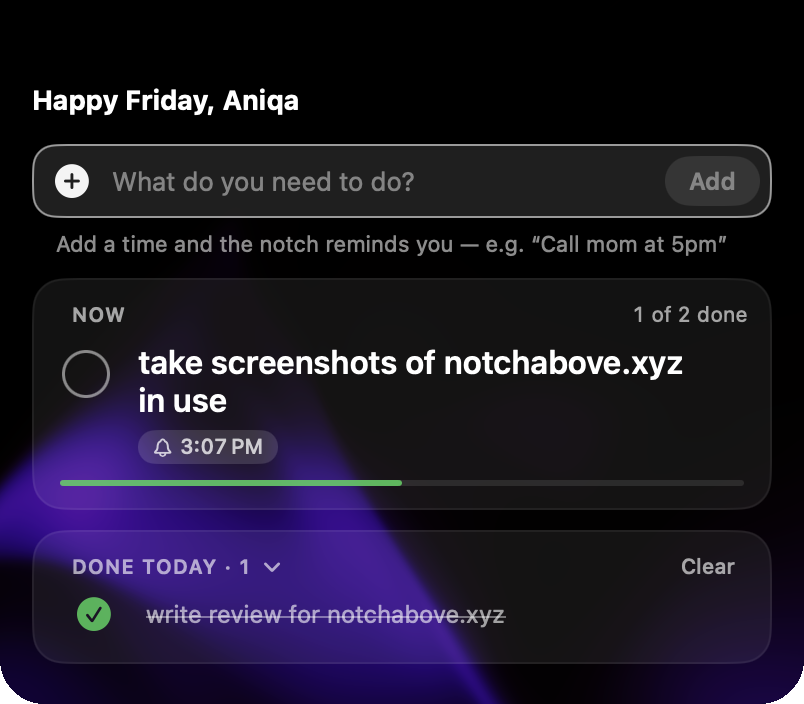
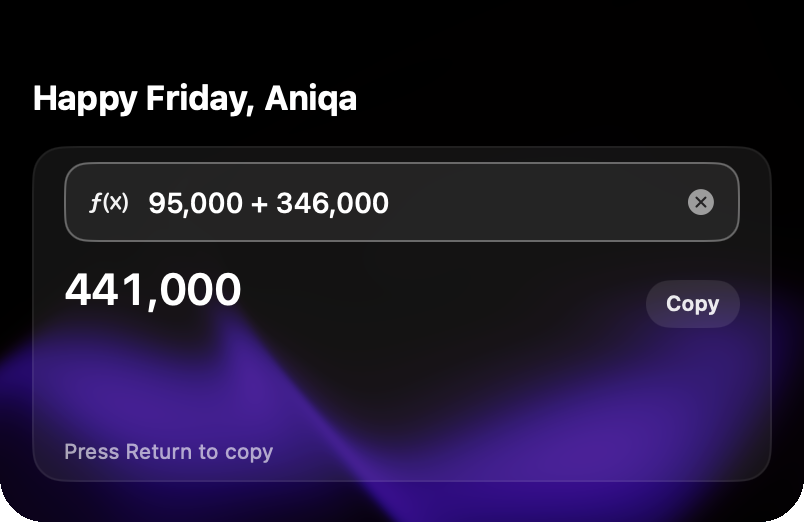

## TL;DR

The notch has always been underused for me. I only ever used it to hold the time, so there was more room in the menu
bar for my apps. NotchAbove freed up that space straight away: it let me delete Vorssaint, Raycast and
[another productivity app]. It fills the notch with the things I reach for all day: audio switching, my AI coding
tools, Git, gentle reminders, a shelf for files and, as a bonus, a black cat named Bombay. It has more than I thought
I needed, but I'm glad to have all of it within easy reach. It's packed with features but feels light, like a native
app, and it's one of the few apps that genuinely brings me joy.

## First look

Downloading it took one extra step: I had to strip the quarantine flag before macOS would let it open on my MacBook.
That's happened with almost every indie app I've tried, so it's not a knock on NotchAbove.

I downloaded NotchAbove halfway through its landing page, so I missed that it comes with a companion and about a
dozen other useful features. I took it for the meeting and calendar view, volume control and webcam preview, and for
being able to customise the notch border and the app's overall look.

Finding Bombay, a beautiful black cat, was such a pleasant surprise. Instead of opening my phone for half a TikTok
between meetings, I can spend that time looking after her, and she peeks out of the notch (if you want her to)
without being distracting. She's really cute, and a great way to keep me off social media in quiet moments.

There's so much packed into it, and that was exciting: I can see it replacing some of my apps and making my work and
development workflow easier over time. Finding all the extra features was a pleasant surprise, and you'll see below
that I'm using quite a lot of them. Usually this many features would overwhelm me, but you can opt in and out of each
one and keep only what you'll actually use.

## What I liked

1. **The pet.** I'm a sucker for a good mascot or companion. I like my tools minimal, but a well-done Easter egg
   brings real joy, as you might notice from the pet on this site that changes with the seasons. Taking care of
   Bombay  and collecting gifts for her gives me a reason to come back, and it's a joy to use. It's
   better than doomscrolling on social media, which can distract me for too long; this is a healthy break with a dose
   of cuteness. And if a cat isn't your thing, you can pick a different pet.

   
   _All sixteen companions, from Bombay to a baby dragon_

2. **Volume control.** This is one of the features that got me interested in the first place. Switching between Zoom
   and Spotify keeps changing my audio settings, and when I'm watching Loom videos attached to bug reports, the volume
   changes even more. It's worse again when I move from my laptop to my desktop setup and back. Here I can set each
   device's volume before I switch and save my preferences, so getting back to them is a hover over the notch and a
   click . It's clearer than the Mac's own volume handling, it's easier to get to, and I don't
   have to fight it.
3. **Reminders that don't feel wrong.** I hate water and stand-up reminders in the usual notification spot. They
   shouldn't take up the same space as an iMessage, and I don't want them on my watch either. Other reminders always
   felt so loud that I'd eventually block them out. NotchAbove is subtle enough to remind me  without
   disrupting me, so I remember I need a break  but can finish what I'm doing first. The
   rest-your-eyes reminder  has me blinking more  after long stretches of
   coding or debugging , and it shows me how much time has passed . As
   someone with chronic dry eyes, this was a nice surprise to try.
4. **Git at a glance.** Lately I've been cleaning up my GitHub and portfolio, which means going back through old
   projects and fixing issues. Seeing my Git status  means I don't forget to clean up a branch or
   commit. I love having this a glance away.
5. **AI agent usage.** Tracking Claude Code, Codex and Cursor in one place  is major. A quick look
   at their limits is nice to have, especially to keep me on track.
6. **The shelf.** I handle files for different clients at work, and my Downloads folder gets ugly fast, and it gets
   ugly when I'm working on personal projects too. Now I put what I need for the week on the shelf ") instead
   of sifting through Downloads. When I was working on some insurance documents, I put everything I needed for the
   email on the shelf for easy access. Loved it.
7. **Calendar view.** I plan my work days by time blocking, so having it in the notch ") helps.
8. **Clipboard history.** I was reluctantly using Raycast for this. It's built around keyboard shortcuts and I never
   enjoyed it, but it was better than nothing. I'm so happy to have deleted it: clipboard history is a hover away
   now  .
9. **Little extras.** The birthday countdown  is awesome, and the camera preview
     reminds me to switch to my dedicated webcam instead of joining a call on
   the MacBook one. It's also a quick way to check that my lighting and background look good.
10. **Make it yours.** There are 21 tabs, which felt like a lot at first, but you can remove what you don't need. You
    can customise the look  and pretty much everything else, and add keyboard shortcuts if you
    want to (I won't). It's all there, but it's just as easy to ignore, which I appreciate for a simple, quick
    workflow.

    
    _The tab grid, with Pet care open_

11. **Easy permissions.** Granting what it needs was simple, with no guesswork.

## What I didn't use

1. **Window management.** I don't really manage my windows. My desktop has enough space that I haven't needed it.
2. **Todos.**  Glad it's there, but work keeps me on Linear, and my personal tasks live on my phone anyway.
3. **Tools.**  Handy if you need exchange rates quickly (they're up to 12 hours old) or some quick
   maths.
4. **Sales.**  Not for me yet, but if I ever become an indie builder, a notification for every
   sale must be a nice dopamine hit.
5. **Games.**  I've been busy with my pet, but as an avid gamer, I know I'll reach for these when I
   finally get a day to be bored.

Even the things I haven't needed are nice to have.

## Small ideas

1. **Expand notes and snippets, lightly.** I dictated a few notes , and I could see saving code snippets
   for debugging or useful prompts there too. Code syntax highlighting would be nice, maybe as something you can
   turn on for a note.
2. **Save notes as Markdown files.** I take notes in Obsidian, and so many people use Markdown editors. Having
   dictated notes land as Markdown files inside my own notes system would be awesome: Obsidian keeps everything in
   local files anyway, so I'd route my notes there and they could sync to my phone or iPad.

## Who it's for

Whether you're technical or not, it's easy to use out of the box. All kinds of productivity tools live in one spot,
and it doesn't ask you to learn or memorise a whole new setup. It's for anyone whose notch is going to waste, who
wants a native-feeling app for everyday tools, and especially anyone who loves a good mascot. I'm shocked one person
made something this thoughtful.
