## TL;DR

The notch has always been underused for me, and NotchAbove fills it with the things I reach for all day: audio
switching, my AI coding tools, Git, gentle reminders, a shelf for files and a black cat named Bombay. It's packed with
features but feels light and native, and it's one of the few apps that genuinely brings me joy. It replaced Raycast
for me, and it can stand in for Vorssaint too.

## First look

Setup took one extra step: I had to strip the quarantine flag before macOS would let it open on my MacBook. That's
happened with almost every indie app I've tried, so it's not a knock on NotchAbove.

I downloaded NotchAbove halfway through its landing page, so I missed that it comes with a companion. Finding Bombay,
a beautiful black cat, was such a pleasant surprise. Instead of opening my phone for half a TikTok between meetings, I
can spend that time looking after her, and she peeks out of the notch (if you want her to) without being distracting.

## What I liked

1. **The pet.** I'm a sucker for a good mascot or companion. I like my tools minimal, but a well-done Easter egg brings
   real joy, and pet care is my favourite part
   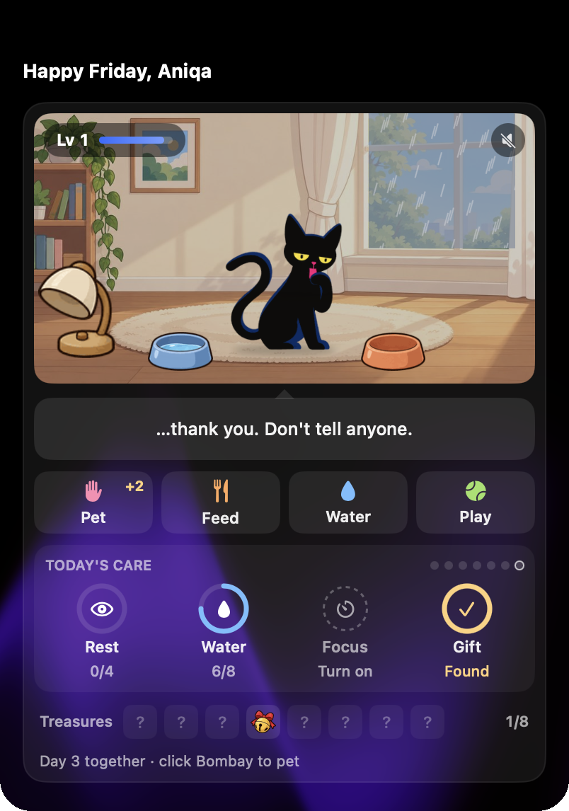.
   You can make it a cat, a dog
   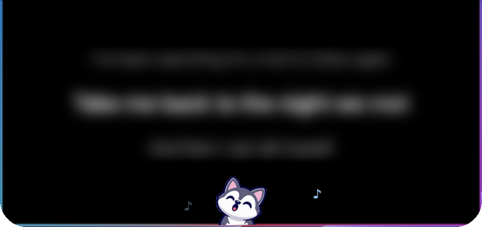
   or a penguin.

   
   _All sixteen companions, from Bombay to a baby dragon_

2. **Volume control.** This is what got me interested. Switching between Zoom and Spotify keeps changing my audio, and
   here I can set each device's volume before I switch
   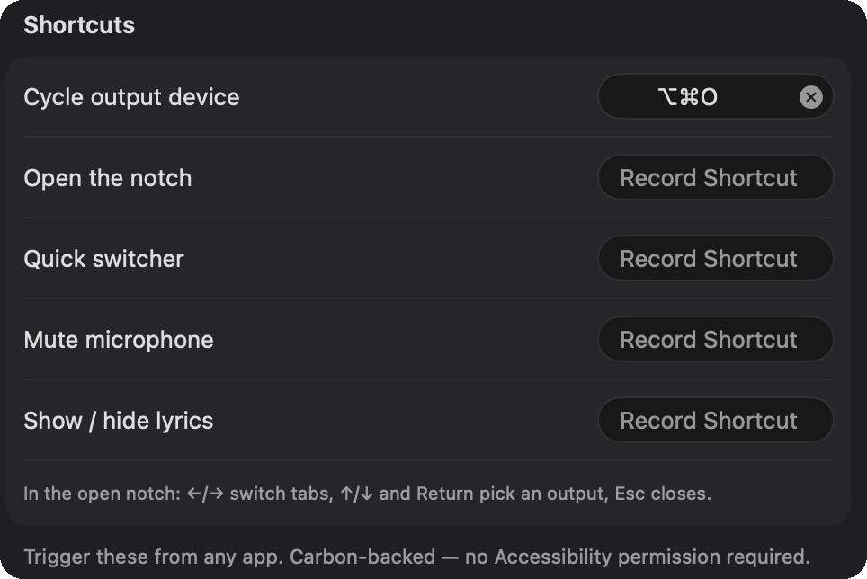. It's clearer than the Mac's own volume handling, and I don't
   have to fight it.
3. **Reminders that don't feel wrong.** I hate water and stand-up reminders in the usual notification spot. NotchAbove
   nudges me gently from the notch
   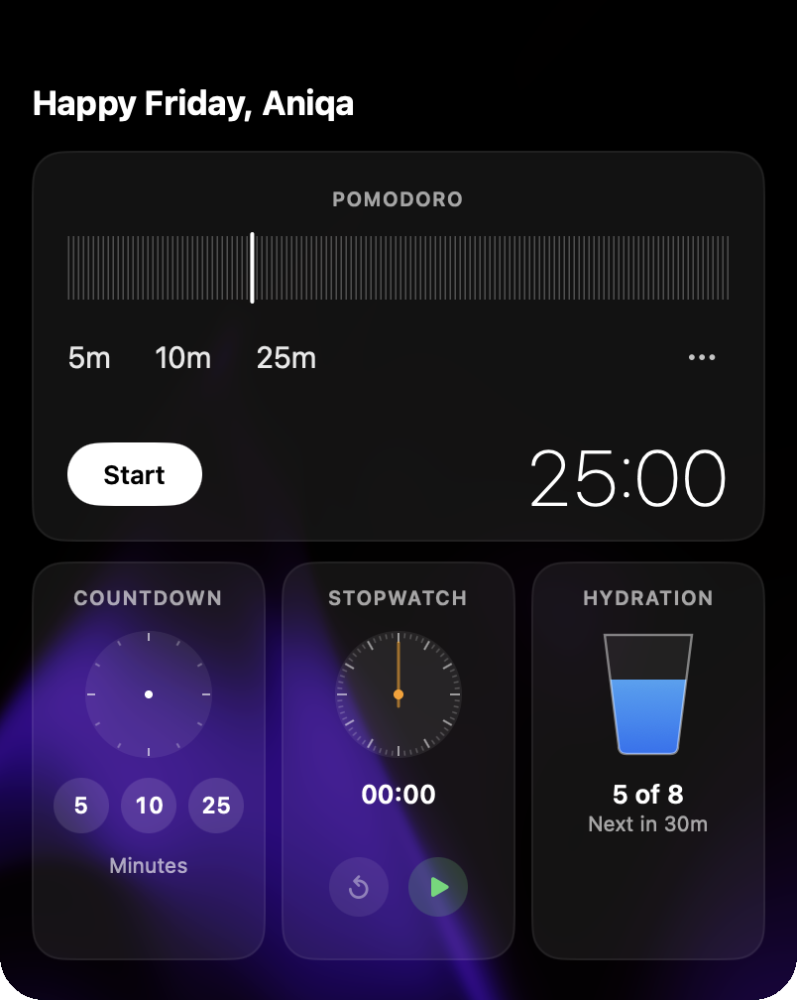, in the middle of the screen, and I actually take them in instead of closing them.
   The rest-your-eyes reminder
   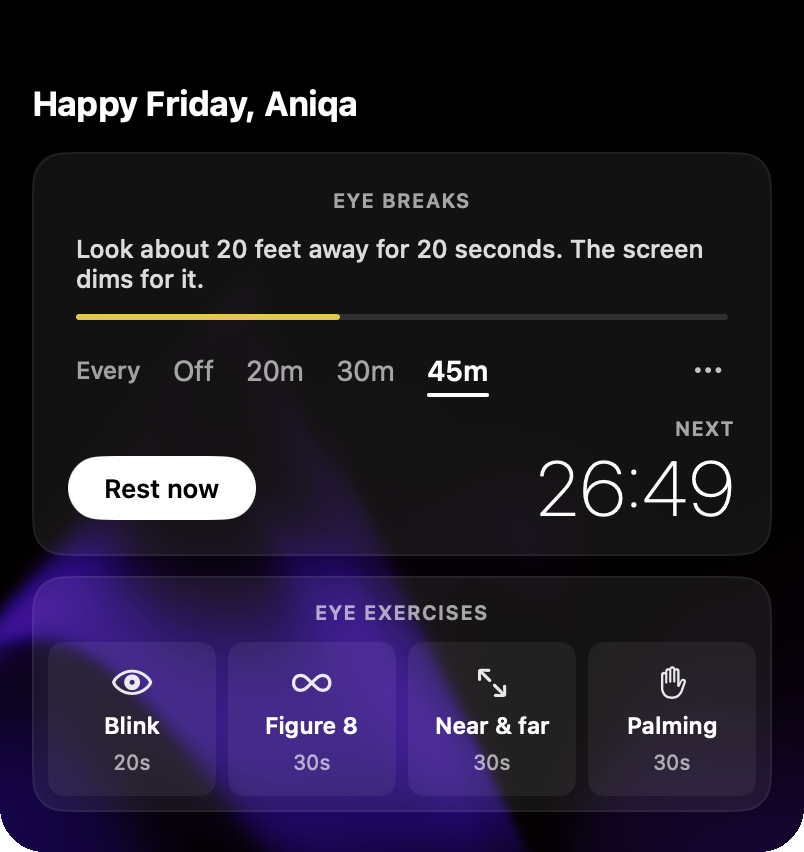
   has me blinking more
   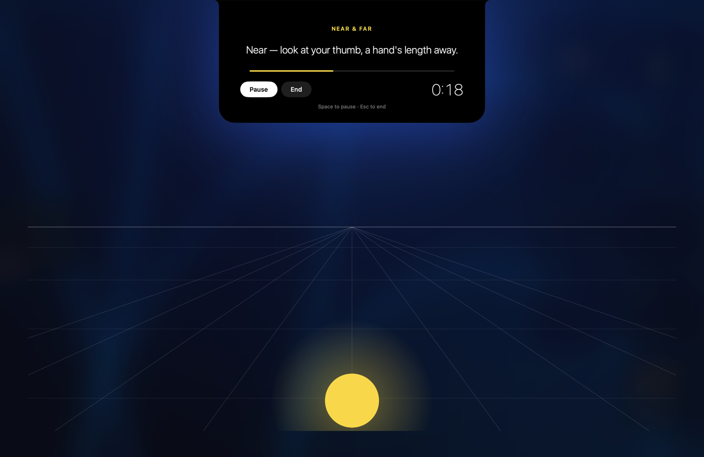
   after long stretches of coding or debugging, and it shows me how
   much time has passed.
4. **Git at a glance.** Lately I'm switching between my portfolio and the projects it ties into, and seeing my Git
   status 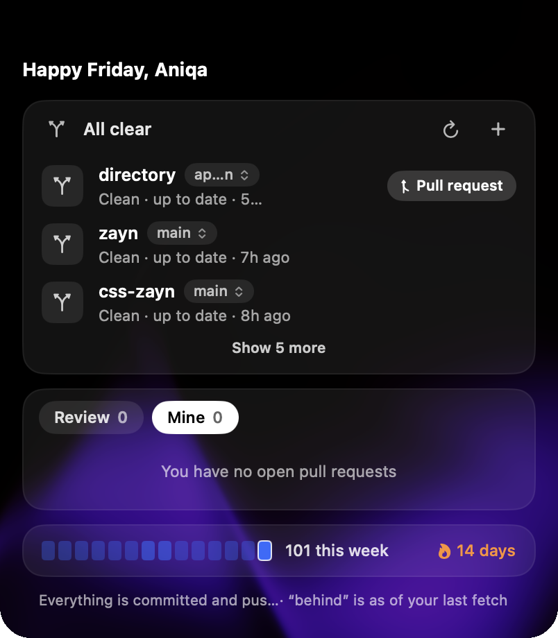
   means I don't forget to clean a branch up.
5. **AI agent usage.** Tracking Claude Code, Codex and Cursor in one place
   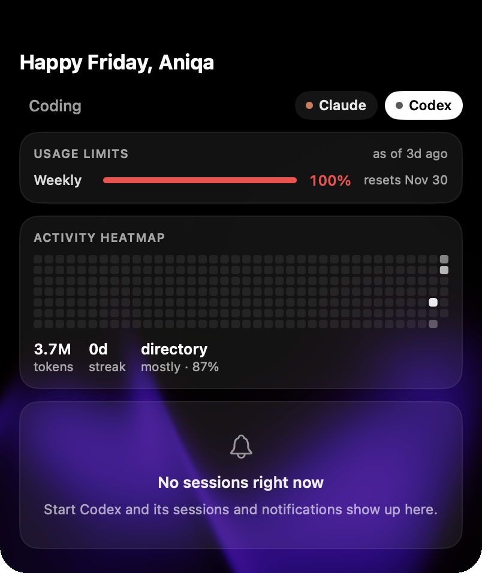
   is major.
6. **The shelf.** I handle files for different clients at work, and my Downloads folder gets ugly fast. Now I put what
   I need for the day or week on the shelf
   ")
   instead of sifting through Downloads.
7. **Calendar view.** Work has my day time-blocked, so having it in the notch
   ")
   helps.
8. **Clipboard history and notes.** I was reluctantly using Raycast for these, but it's built around keyboard
   shortcuts and I never enjoyed it, so I deleted it
   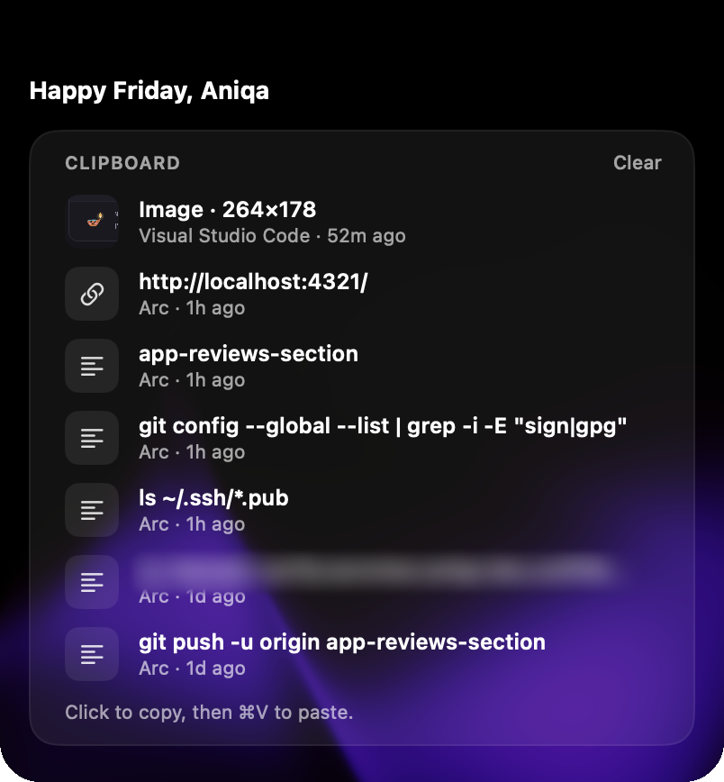
   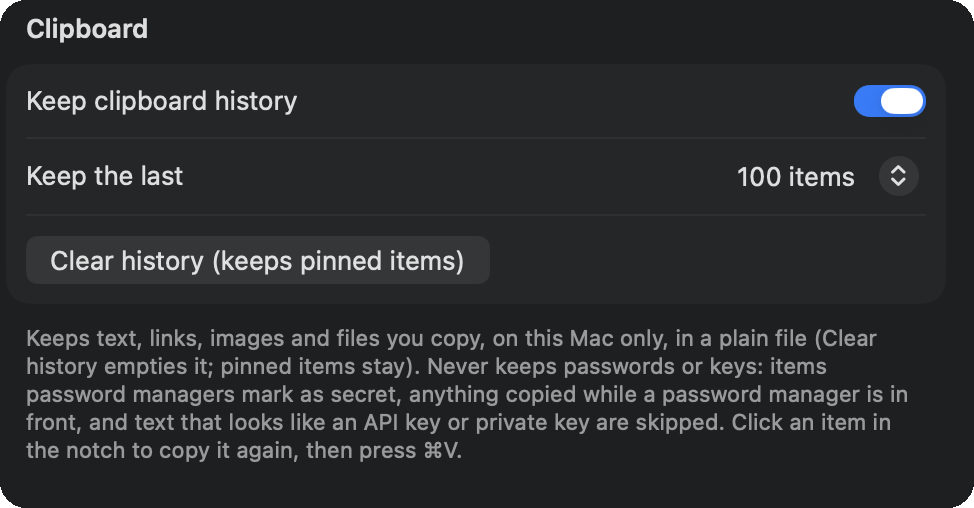.
9. **Little extras.** The birthday countdown
   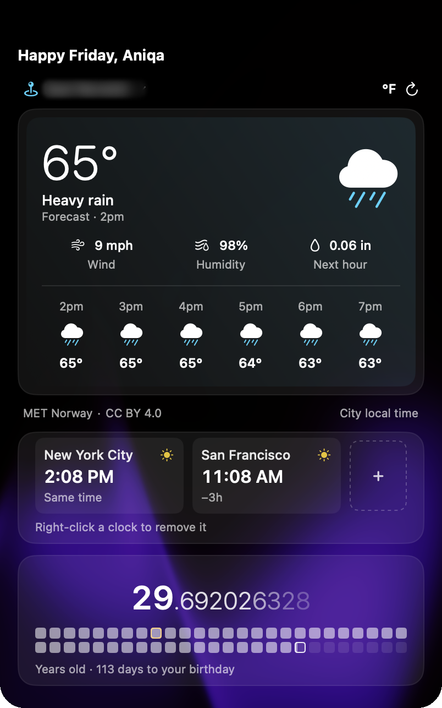
   is awesome, and the camera preview
   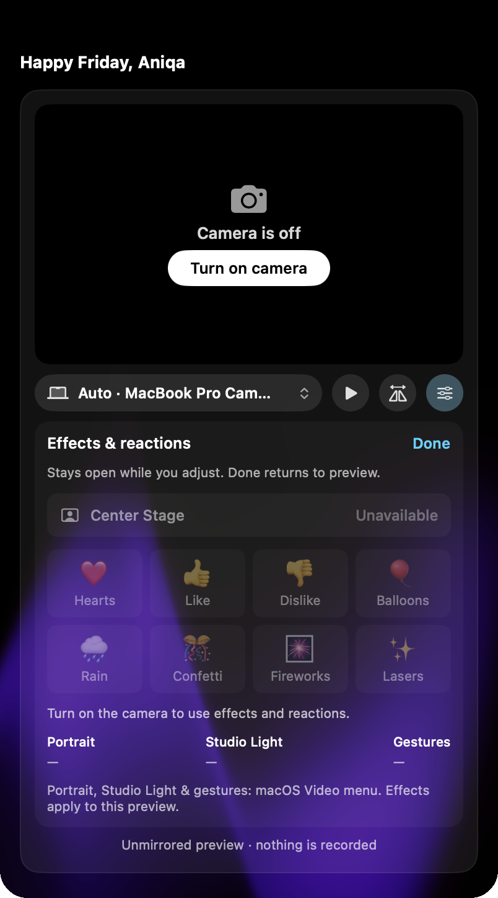
   reminds me to switch to my webcam
   instead of joining a call on the MacBook one.
10. **Make it yours.** There are 21 tabs, which felt like a lot at first, but you can remove what you don't need. Say
    less. You can customise the look
    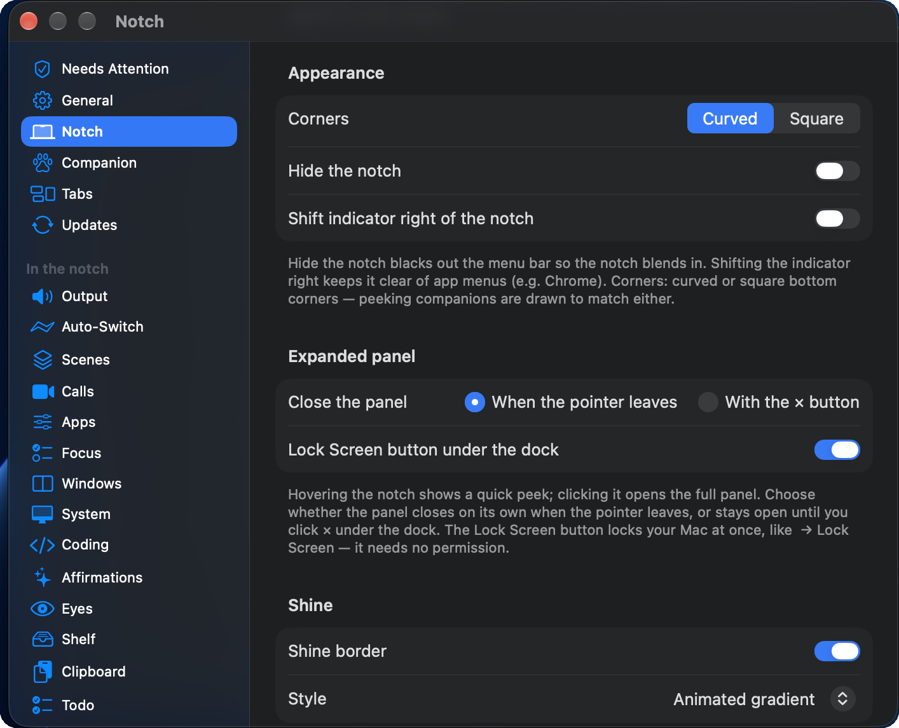
    and pretty much everything else.

    
    _The tab grid, with Pet care open_

11. **Easy permissions.** Granting what it needs was simple.

## What I didn't use

1. **Window management.** I don't really manage windows anyway.
2. **Todos.** Glad it's there, but work keeps me on Linear.
3. **Tools.** Handy if you need exchange rates quickly (they're up to 12 hours old).
4. **Sales.**
   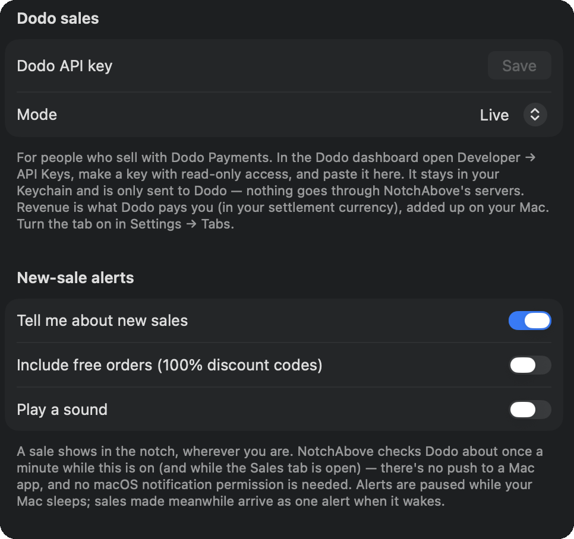
   Not for me yet, but if I ever become an indie builder, a notification for every sale must be a nice
   dopamine hit.
5. **Games.**
   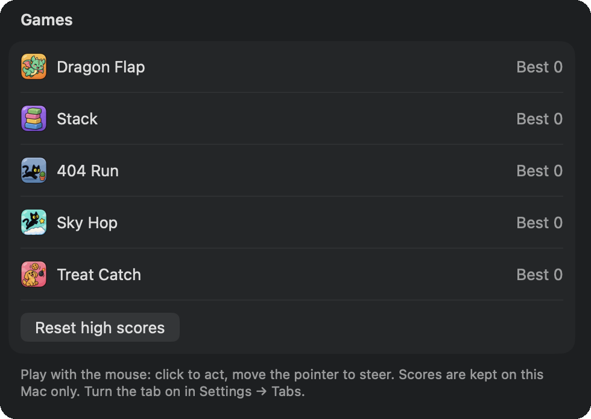
   I've been busy with my pet, but the holidays are our slower season, so I'll try them and update this.

## Small ideas

1. Expand notes and snippets in a lightweight way. I dictated a few notes
   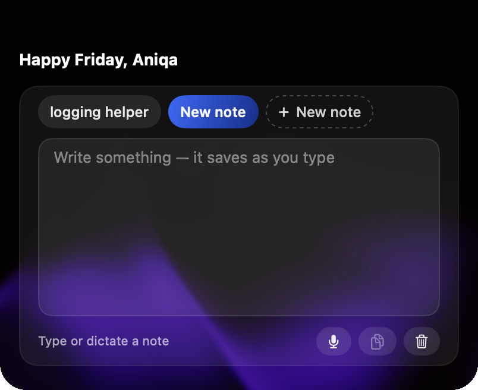, and I could see saving code snippets for
   debugging or useful prompts there too.
2. Save notes as Markdown files. I take notes in Obsidian, and so many people use Markdown editors; having dictated
   notes land as Markdown files inside my own notes system would be awesome.

## Who it's for

Anyone whose notch is going to waste, who wants a calm, native-feeling home for everyday tools, and especially anyone
who loves a good mascot. I'm shocked one person made something this thoughtful.
