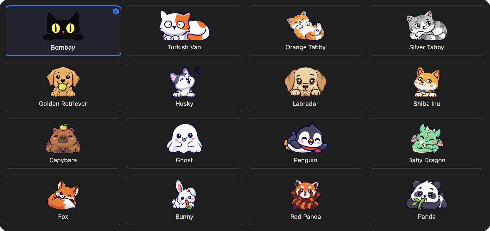
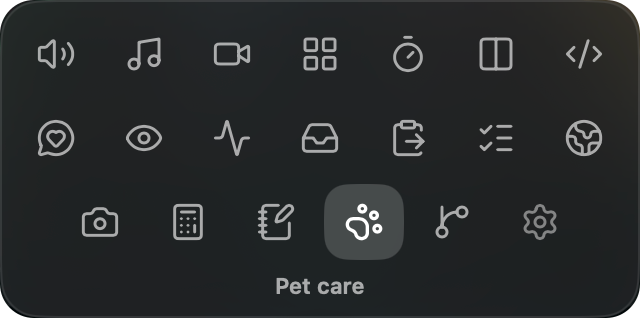

## TL;DR

I never really used the MacBook notch. I didn't even know it could do more than show the time, so it just held my
clock to give my menu bar icons more room.

NotchAbove fills it with the things I reach for all day: audio switching, my AI coding tools, Git, gentle reminders, a
shelf for files and a (cute) black cat named Bombay. It's packed with features  but feels light and
native, it's one of the few apps that genuinely brings me joy, and it's easy to fit into your workflow. It also freed
up my menu bar straight away: I deleted Raycast and Vorssaint.

## First look

The download instructions were easy, but I had to strip the quarantine flag before it would open on my MacBook.
That's happened with almost every indie or non-App Store app I've tried, so it's not a knock on NotchAbove.

I first downloaded NotchAbove for the calendar view, volume control, webcam preview and a notch I could style. I was
hooked halfway through the landing page and never read the rest, so I missed a dozen other useful features. That many
features would usually overwhelm me, but each one is opt-in , so I keep just what I use.

Finding Bombay, a cat companion, was also such a pleasant surprise. Instead of opening my phone for half a TikTok
between meetings, I can spend that time looking after her, and she peeks out of the notch (if you want her to) without
being distracting.

## What I liked

1. **The pet.** I'm a sucker for a good mascot or companion _(you might have noticed the one on this site)_. I like my
   tools minimal, but a well-done Easter egg brings real joy, and the pet care is my favorite part .
   Collecting gifts for Bombay gives me a reason to come back and not lose time doomscrolling.

   
   _All sixteen companions, from Bombay to a baby dragon_

2. **Volume control.** Switching between Zoom and Spotify keeps changing my audio, Loom videos on bug reports change it
   again, and moving between my laptop and desktop makes it worse. Here I can set each device's volume before I switch
    and get back to it with a hover and a click. It's clearer than the Mac's own volume handling, and
   I don't have to fight it.
3. **Reminders that don't feel wrong.** Other apps have reminders too, but I hate getting water and stand-up reminders
   in the usual notification spot; they shouldn't take the same space as a message or calendar event. NotchAbove
   nudges me gently from the notch, and I actually take them in (even if I finish what I'm doing first).
   - Water sits next to a Pomodoro timer, a countdown and a stopwatch .
   - The eye breaks matter most, since I have chronic dry eyes. After long stretches of coding or debugging, the
     reminder has me blinking more, and it comes with short exercises  .
   - I can also see where my time goes: how long I've been on screen today, and in which apps .
4. **Git at a glance.** Lately I'm cleaning up old projects for my portfolio, and seeing my Git status 
   means I don't forget to commit or clean a branch up.
5. **AI agent usage.** Tracking Claude Code, Codex and Cursor in one place  is major. A quick look at
   my limits keeps me on track.
6. **The shelf.** I handle files for different clients at work, and my Downloads folder gets ugly fast. Now what I
   need for the week sits on the shelf ') instead.
7. **Calendar view.** Work has my day time-blocked to the minute, and I'm keeping up with my husband's changing
   schedule too, so having it all in the notch helps ').
8. **Clipboard history.** I reluctantly used Raycast for this, but it's built around keyboard shortcuts, and I'd end up
   in Spotlight anyway. Now my history is a hover away in the notch and much easier for me to get to 
   .
9. **Little extras.** The birthday countdown ') is awesome, and the camera preview
    reminds me to switch to my webcam and check my lighting before a call.
10. **Make it yours.** There are 21 tabs with truly useful features. It felt like a lot at first, but you can remove
    what you don't need. You can customize the look  and pretty much everything else, and add
    shortcuts if you want them _(I won't)_ .

    
    _The tab grid, with Pet care open_

11. **Easy permissions.** Granting what it needs was simple.

## What I didn't use

1. **Window management.**  I don't really manage windows anyway.
2. **Music.** Controls and lyrics in the notch ') are super cool, but for my work laptop, a quick
   play and pause is good enough.
3. **Todos.**  Glad it's there, but work keeps me on Linear and my personal tasks live on my phone.
4. **Tools.**  Handy if you need exchange rates quickly (they're up to 12 hours old). I like that
   conversions get their own space, whereas Raycast folds them into its search.
5. **Sales.**  Not for me yet, but if I ever become an indie builder, a notification for every sale
   must be a nice dopamine hit.
6. **Games.**  I've been busy with my pet, but as a gamer, I'll reach for these once I'm bored
   enough.
7. **Affirmations.**  Nice if you want a little encouragement throughout the day, but personally, I'd
   rather not add the noise.

## Small ideas

1. Show usage for more than one account. I'd love to see my AI agent usage across accounts, like my personal and work
   Claude accounts, side by side.
2. Save notes  as Markdown files. I take notes in Obsidian, like so many people with Markdown editors. Having
   these land as Markdown files in my own notes would be awesome, and they'd sync to my phone and iPad.
3. Add app management. An uninstaller, a cache cleaner and app updates would make it an even fuller replacement for
   Vorssaint. That's what originally appealed to me about it, so it's all I'm missing at the moment.

## Who it's for

Anyone, technical or not, whose notch is going to waste, who wants a calm, native-feeling home for everyday tools, and
especially anyone who loves a good mascot. I'm shocked one person made something this thoughtful. It's my favorite
all-in-one productivity tool for 2026 and likely 2027.
